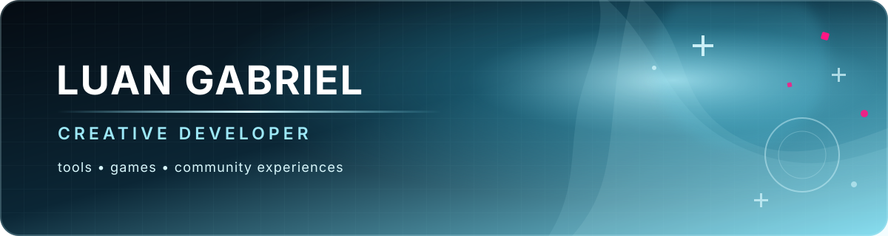

  

  
  
  

## Olá, eu sou o Luan 👋

Sou um desenvolvedor criativo que gosta de transformar ideias em **ferramentas para jogos**, **experiências interativas** e projetos que aproximam comunidades.

Meu interesse não termina quando o código funciona: gosto de pensar na identidade visual, na facilidade de uso e na experiência de quem está do outro lado.

- 🎨 Crio ferramentas que ajudam outras pessoas a produzir e personalizar conteúdo.
- 🎮 Gosto de jogos 2D, sistemas interativos e projetos com personalidade.
- 🫂 Construo experiências pensadas para comunidades online.
- ✨ Tento fazer cada projeto parecer algo feito por alguém, e não apenas por uma máquina.

## Projetos em destaque

### 🎃 [HalloweenBot](https://github.com/LuaNzCraft/HalloweenBot)

Uma experiência interativa de Halloween para comunidades no Discord, com economia, missões, minijogos, eventos sociais e ferramentas para criação de conteúdo próprio.

### 🎨 [B-SIDE](https://github.com/LuaNzCraft/B-SIDE)

Editor independente de skins e sprites para jogos 2D e Celeste.

### 🎮 [Grand Chase Discord Rich Presence](https://github.com/LuaNzCraft/Grand-Chase-Discord-Rich-Presence)

Integração que acompanha o progresso do Grand Chase e o apresenta como atividade no Discord.

## Tecnologias que aparecem nos meus projetos

  
  
  
  
  
  

---

  <em>Código é só uma parte. A experiência que ele cria é o que fica.</em>

